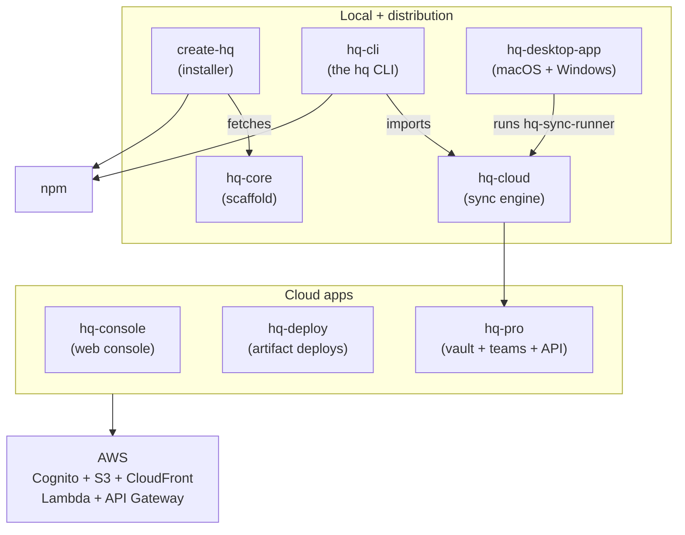
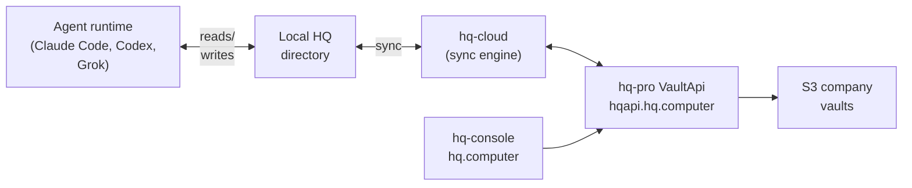
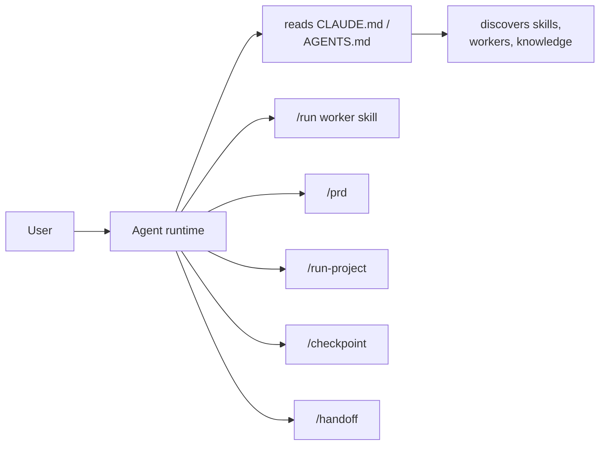
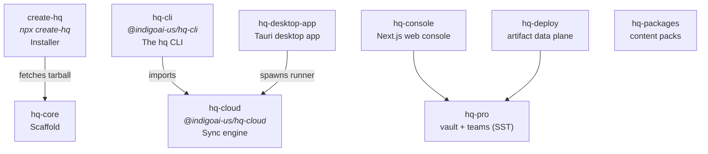
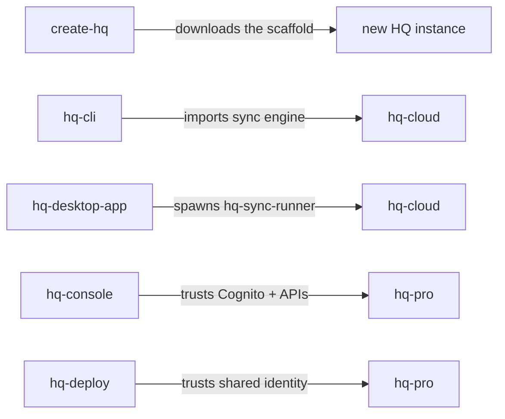

## System Architecture

HQ ships as a set of independently versioned repos: a scaffold and its installer, a CLI, a cloud sync engine, a desktop app, an admin console, and shared cloud infrastructure. The user works in HQ through an agent runtime (Claude Code, Codex, or Grok; Cursor gets a rules file only) on the local HQ directory, and optionally through the HQ desktop app and the web console. Cloud sync connects the local directory to per-company vaults on S3. See the [Ecosystem & Repo Map](/hq/architecture/2-ecosystem/) for how the repos compose.

### Runtime Flow

## Data Flow

### 1. Install

There are two install paths:

- **Desktop:** the HQ desktop app (macOS and Windows) runs an onboarding installer on first launch, then becomes the sync and workspace app.
- **Terminal:** `npx create-hq` downloads the hq-core scaffold from GitHub, checks dependencies, and optionally installs `@indigoai-us/hq-cli` and the recommended content packs. It requires Node.js 22.13+ and git.

### 2. Setup

The `/setup` skill walks through first-run configuration: companies, workers, knowledge, and search indexing.

### 3. Work

Daily work happens through the agent runtime:

State lives in the filesystem. Workers read knowledge, write reports, update threads, and commit to git repos.

### 4. Sync

`hq-cloud` syncs a cloud-backed company's files between the local HQ directory and that company's vault bucket on S3. Each sync call gets a Cognito token, asks the hq-pro vault service for STS-vended credentials scoped to the company, and transfers files. What syncs is set by `.hqignore` and the membership's sync mode (`shared`, `all`, or `custom`). Sync runs in the background from the desktop app, or on demand with `hq sync now`, `hq sync push`, and `hq sync pull`.

### 5. Web and mobile

The web surface is hq-console at `hq.computer`. Native iOS (beta) and Android apps are built from the hq-native-mobile repo. The cloud API (`VaultApi` in hq-pro) is served at `https://hqapi.hq.computer`.

## Repo Graph

Each surface is its own repo and ships on its own cadence. For the full breakdown, see the [Ecosystem & Repo Map](/hq/architecture/2-ecosystem/).

### Dependency Direction

The repos are loosely coupled. `create-hq` seeds a new instance from hq-core at install time and has no runtime role after that. `hq-cli` is the main user-facing package and depends on `hq-cloud` for sync; the desktop app runs the same engine through its `hq-sync-runner` binary. The cloud apps (`hq-console`, `hq-deploy`) have no user store of their own; they trust the shared Cognito pool provisioned by `hq-pro`.

## Technology Stack

### Core

| Technology | Purpose | Notes |
|---|---|---|
| **Node.js** | Runtime | hq-cli requires Node ≥20; create-hq requires Node ≥22.13 |
| **TypeScript** | Language | Used across the CLI, sync engine, and cloud repos |
| **pnpm** | Package manager | hq-cli, hq-cloud, hq-pro, hq-console, and hq-desktop-app; create-hq and hq-deploy use npm |

### CLI + sync packages

| Technology | Package | Purpose |
|---|---|---|
| **Commander.js** | hq-cli | CLI framework |
| **AWS SDK v3** | hq-cloud | S3 and Cognito clients |
| **simple-git** | hq-cli | Git operations for `hq modules` |

### Desktop (hq-desktop-app)

| Technology | Purpose |
|---|---|
| **Tauri 2** | App shell with a Rust backend, for macOS and Windows |
| **Svelte 5** | UI framework |
| **Vite** | Build tool |

### Web and cloud apps (hq-console, hq-pro, hq-deploy)

| Technology | Purpose |
|---|---|
| **Next.js 15 / React 19** | hq-console UI |
| **NextAuth v5** | hq-console auth over the shared Cognito pool |
| **SST 4** | hq-pro infrastructure on AWS |
| **Hono** | hq-deploy API |

### Documentation (this site)

| Technology | Purpose |
|---|---|
| **Astro** | Static site framework |
| **Starlight** | Documentation theme with search |
| **MDX** | Markdown with component support |

### Shared infrastructure

| Technology | Purpose |
|---|---|
| **AWS Cognito** | One identity pool shared across the cloud apps |
| **AWS S3** | Per-company vault buckets |
| **Lambda + API Gateway** | Serverless endpoints for vault, sync, and deploy |
| **CloudFront** | CDN for assets and APIs |

### Why These Choices

**Split repos:** each surface (installer, scaffold, CLI, sync engine, desktop app, cloud apps) ships on its own cadence and version. A CLI release does not touch the desktop app, and each repo's CI stays scoped. The repos compose through published npm packages, GitHub Releases, and a shared Cognito identity.

**SST for hq-pro:** TypeScript-native infrastructure definitions, in the same language as the services.

**Astro Starlight for docs:** built for documentation, with search and navigation included and no client JavaScript by default.

**Tauri for the desktop app:** a Rust backend with the system webview instead of a bundled Chromium, which keeps the download small for a background sync app.
