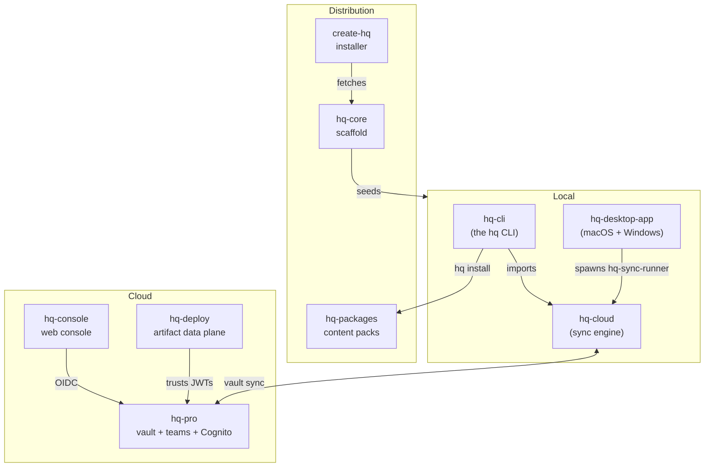

HQ is a set of independently versioned repos that compose through published npm packages, GitHub Releases, and one shared AWS Cognito identity. Each repo ships on its own cadence. A CLI release does not require a desktop app release, and the cloud apps deploy independently of the scaffold.

## The repos at a glance

| Repo | Ships as | What it is |
|------|----------|------------|
| **hq-core** | GitHub releases (tarball) | The scaffold for an HQ instance: skills, policies, scripts, and runtime config for Claude Code (`.claude/`), Codex (`.codex/`), Cursor (`.cursor/`), and Grok (`.grok/`). Changes land in hq-core-staging first. |
| **create-hq** | `npx create-hq` | The terminal installer. Downloads the hq-core scaffold, checks dependencies, and offers hq-cli and the recommended packs. |
| **hq-cli** | `@indigoai-us/hq-cli` | The `hq` CLI: sign-in, packs, cloud sync, files, secrets, DMs, integrations, bots, and diagnostics. |
| **hq-cloud** | `@indigoai-us/hq-cloud` | The sync engine behind the CLI and the desktop app. Ships the `hq-sync-runner` binary. |
| **hq-desktop-app** | macOS and Windows app (GitHub Releases) | Tauri 2 app that runs onboarding on first launch, then syncs in the background and hosts the desktop workspace. Replaces the earlier hq-sync, hq-sync-win, and hq-installer apps. |
| **hq-console** | Next.js app (`hq.computer`) | Web console for companies, teams, files, deploys, and usage. |
| **hq-deploy** | AWS data plane | Serves deployed web artifacts on subdomains; deploy-management API. |
| **hq-pro** | SST app on AWS | The vault, team platform, `VaultApi` (`hqapi.hq.computer`), and shared Cognito identity. |
| **hq-packages** | Content packs (`packages/hq-pack-*`) | Optional packs installed into an HQ instance with `hq install`. |

Each product has a dedicated page under [Products](/hq/products/hq-core/).

## How they compose

### Composition rules

- **The scaffold seeds an instance.** `create-hq` (or the desktop app's onboarding) lays down hq-core once. Later core updates come from new hq-core releases, applied with `/update-hq` or `hq rescue`, not through a shared package dependency.
- **The CLI owns sync commands; the engine does the work.** `hq-cli` depends on `@indigoai-us/hq-cloud` and loads it only when a sync command runs. `hq-cloud` also ships `hq-sync-runner`, which emits ndjson sync events.
- **The desktop app is a GUI over the same engine.** `hq-desktop-app` spawns `hq-sync-runner` and renders its progress. See [hq-sync](/hq/products/hq-sync/) and [hq-cloud](/hq/products/hq-cloud/).
- **One identity, many apps.** `hq-pro` provisions the shared Cognito pool and the vault. `hq-console` authenticates against it (NextAuth/OIDC) and `hq-deploy` trusts JWTs minted by it. Neither has its own user store.
- **Capabilities install as packs.** Optional add-ons (design styles, Slack bots, and others) live in `hq-packages`. hq-core's `core/core.yaml` lists the recommended packs by GitHub source, for example `hq install github:indigoai-us/hq-packages#packages/hq-pack-design-styles`. See [hq-packages](/hq/products/hq-packages/overview/).

## Versioning

Each repo carries and releases its own version:

| Repo | Current version | Release mechanism |
|------|-----------------|-------------------|
| hq-core | `hqVersion` 16.0.x (`core/core.yaml`) | hq-core-staging → `promote-to-hq-core` workflow opens a `release: v<ver>` PR on hq-core; merging it tags and cuts the release |
| create-hq | 10.x | Push a `v*` tag; CI publishes to npm |
| hq-cli | `@indigoai-us/hq-cli` 5.x | Push a `v*` tag; CI publishes to npm with OIDC trusted publishing |
| hq-cloud | `@indigoai-us/hq-cloud` 6.x | Push a `v*` tag; CI publishes to npm |
| hq-desktop-app | 0.11.x (`versions.toml`) | `v*` tag → signed macOS and Windows builds plus updater manifests on GitHub Releases |
| hq-console / hq-deploy / hq-pro | per-repo | Vercel (hq-console) and AWS deploys |
| hq-packages | per-pack `version` in `package.yaml` | `release.yml` on push to main publishes changed packs to npm |

> Older package metadata may still point `repository.url` at the archived combined repo. The split repos above are canonical.

## Where to go next

- [hq-cli deep dive](/hq/architecture/4-hq-cli/): command registration, module management, and sync commands
- [Module system](/hq/architecture/8-module-system/): how external repos plug in
- [Products](/hq/products/hq-core/): per-product pages
