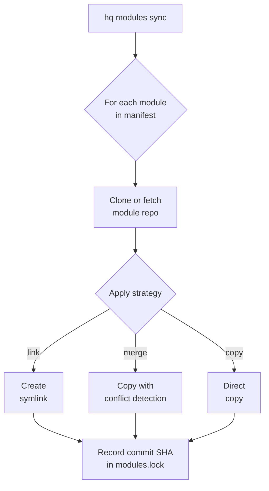

The `@indigoai-us/hq-cli` package is the `hq` command, the management CLI for HQ. It requires Node.js 20 or later. It registers about 70 top-level command groups covering sign-in, packs, cloud sync, files, secrets, DMs, integrations, bots, billing, and diagnostics. This page covers three of them in depth: **module management**, **cloud sync** (bridging to `@indigoai-us/hq-cloud`), and the **work mesh**.

> One repo in the split [HQ ecosystem](/hq/architecture/2-ecosystem/) — published as `@indigoai-us/hq-cli`, depending on `@indigoai-us/hq-cloud` for sync.

Built with [Commander.js](https://github.com/tj/commander.js). Commands are listed in `src/command-registration-plan.ts` and registered lazily, so a command's module (and `@indigoai-us/hq-cloud`, for sync) loads only when that command runs. The groups covered here:

```
hq modules <add|sync|list|update>
hq login | hq cloud <provision|retire|demote>
hq sync <push|pull|status|now|doctor|mode|narrow|manifest|held|release-held>
hq mesh <check|start|progress|blocked|done|note|story|claim|doctor|daemon|...>
```

Run `hq --help` or `hq <command> --help` for the full list.

## Module Commands

### `hq modules add <repo-url>`

Registers a module in the manifest (`modules/modules.yaml` on a fresh HQ). Validates the repo URL, parses the repo name, builds a module definition, and appends it. It does not clone; `hq modules sync` does that.

```bash
hq modules add https://github.com/org/knowledge-ralph.git \
  --as ralph \
  --branch main \
  --strategy link \
  --path "docs:knowledge/public/Ralph"
```

| Option | Default | Description |
|--------|---------|-------------|
| `--as <name>` | Parsed from URL | Module name |
| `--branch <branch>` | `main` | Git branch to track |
| `--strategy <strategy>` | `link` | Sync strategy: `link`, `merge`, or `copy` |
| `--path <src:dest>` | `.:workers/<name>` | Path mapping (repeatable) |

### `hq modules sync`

The core sync loop. For each module in the manifest:



1. **Clone or fetch** the module repo into `modules/<name>/`
2. **Apply the sync strategy** (link, merge, or copy) based on path mappings
3. **Record the commit SHA** in `modules.lock`

```bash
hq modules sync          # Sync all to latest
hq modules sync --locked # Sync to locked commits
```

The `--locked` flag checks out the exact commit recorded in `modules.lock` instead of pulling latest. This enables reproducible installs across machines.

On first run, `modules/` is automatically added to `.gitignore` since cloned repos should not be tracked by HQ git.

### `hq modules list`

Displays every module in the manifest with its repo or pack source, strategy, and commit.

```bash
hq modules list   # or: hq modules ls
```

### `hq modules update [module-name]`

Fetches and pulls the module clone, then writes the new commit SHA to `modules.lock`. It does not re-apply the sync strategy. If no module name is given, all modules are updated.

```bash
hq modules update ralph   # Update one module's lock
hq modules update         # Update all locks
```

## Type System

All types are defined in `src/types.ts`:

```typescript
type LegacyStrategy = 'link' | 'merge' | 'copy';
type AccessLevel = 'public' | 'team' | `role:${string}`;

interface PathMapping {
  src: string;   // Path within module repo
  dest: string;  // Path in HQ tree (relative to HQ root)
}

interface LegacyModuleDefinition {
  name: string;
  repo: string;              // Git URL (https or git@)
  branch?: string;           // Default: main
  strategy: LegacyStrategy;
  paths: PathMapping[];
  access?: AccessLevel;
}

interface PackModuleDefinition {   // written by `hq install`
  name: string;
  strategy: 'package';
  source: string;            // '@scope/name@ver' | git URL#sha | local path
  version?: string;
  installed_at?: string;
  installed_at_iso?: string;
  resolved_sha?: string;
  access?: AccessLevel;
}

type ModuleDefinition = LegacyModuleDefinition | PackModuleDefinition;

interface ModulesManifest {
  version: '1';
  modules: ModuleDefinition[];
}

interface ModuleLock {
  version: '1';
  locked: Record<string, string>; // module name -> commit SHA
}
```

The manifest stores modules as an array (not a record), so ordering is preserved. `hq modules sync` skips `package` entries; content packs are wired by the pack installer. The lock file maps module names to commit SHAs for deterministic installs.

### SyncState

The merge strategy tracks per-file state for conflict detection:

```typescript
interface SyncState {
  version: '1';
  files: Record<string, {
    hash: string;          // SHA256 of file content at sync time
    syncedAt: string;      // ISO timestamp
    fromModule: string;    // Module that provided this file
  }>;
}
```

This is persisted to `.hq-sync-state.json` at the HQ root and used by the merge strategy to detect local modifications.

## Manifest Utilities

`src/utils/manifest.ts` provides all file I/O for the module system:

| Function | Purpose |
|----------|---------|
| `findHqRoot()` | Walks up the directory tree looking for `.claude/` or `workers/` directory |
| `readManifest()` / `writeManifest()` | YAML read/write for `modules/modules.yaml` (falls back to a flat `modules.yaml` at the root if one exists) |
| `readLock()` / `writeLock()` | YAML read/write for `modules.lock` |
| `readState()` / `writeState()` | JSON read/write for `.hq-sync-state.json` |
| `addModule()` | Appends a `ModuleDefinition` to the manifest (with duplicate check) |
| `parseRepoName()` | Extracts the repo name from a GitHub URL (handles both HTTPS and SSH formats) |
| `isValidRepoUrl()` | Validates that a URL starts with `https://` or `git@` |

## Git Utilities

`src/utils/git.ts` wraps [simple-git](https://github.com/steveukx/git-js) for repository operations:

| Function | Purpose |
|----------|---------|
| `cloneRepo()` | Clones a repo with optional branch selection |
| `fetchRepo()` | Fetches all remotes |
| `pullRepo()` | Pulls latest changes |
| `getCurrentCommit()` | Returns the HEAD commit SHA |
| `checkoutCommit()` | Checks out a specific commit (for locked installs) |
| `isRepo()` | Checks if a directory is a valid git repository |
| `isBehindRemote()` | Fetches and checks if local is behind remote |
| `ensureGitignore()` | Appends an entry to `.gitignore` if not already present |

## Sync Strategies

Each strategy is implemented as an async function that takes a `ModuleDefinition`, the module's local directory, and the HQ root, returning a `SyncResult`.

### Link Strategy

**File:** `src/strategies/link.ts`

Creates relative symlinks from the module repo into the HQ tree. This is the default strategy and is used for knowledge bases where files should remain in their git repo and be transparently accessible from HQ paths.

For each path mapping:
1. Validates the source path exists in the module repo
2. Creates parent directories at the destination if needed
3. If an existing symlink is found at the destination, removes and recreates it
4. If a real file or directory exists, warns and skips (does not overwrite)
5. Computes a **relative** symlink path for portability across machines

Relative symlinks mean the link still works if the entire HQ directory is moved, as long as the internal structure is preserved.

### Merge Strategy

**File:** `src/strategies/merge.ts`

Copies files from the module repo into the HQ tree with SHA256-based conflict detection. This is used for content that should be owned by HQ after initial sync (commands, templates, configuration).

The merge logic for each file:
1. Compute the SHA256 hash of the source file
2. If the destination file exists, compute its hash
3. Look up the hash recorded at last sync time from `.hq-sync-state.json`
4. **Skip (conflict)** if the destination was modified since last sync *and* differs from the source — the user's local changes are preserved
5. **Skip (unchanged)** if source and destination hashes match
6. **Copy** the file and record the new hash in sync state

This three-way comparison (source, destination, last-synced) prevents overwriting local customizations while still pulling upstream changes for unmodified files.

### Copy Strategy

Planned. Currently falls through to the merge strategy implementation.

## Cloud Commands

**Files:** `src/commands/cloud.ts`, `cloud-provision.ts`, `sync-mode.ts`, `sync-narrow.ts`, `sync-manifest.ts`, `sync-held.ts`

Cloud sync has no init step and no CLI-managed background daemon. Each `hq sync` invocation resolves a Cognito access token, asks the vault service for the company's bucket and STS-vended credentials, runs the operation, and exits. The setup path is:

```bash
hq login                 # Cognito sign-in; tokens cached in ~/.hq/cognito-tokens.json
hq cloud provision ...   # make a company cloud-backed (entity + bucket + initial sync)
hq sync now              # push local changes, then pull remote updates
```

The HQ desktop app signs in and runs the same engine in the background, so desktop users do not need these commands.

| Command | Description |
|---------|-------------|
| `hq sync push [paths...]` | Push local files to the company vault on S3 |
| `hq sync pull` | Pull permitted files from the company vault to local HQ |
| `hq sync now` | Push, then pull (the desktop app's "Sync Now") |
| `hq sync status` | Show the local sync journal summary |
| `hq sync doctor --reconcile-conflicts [--yes] [--hq-root <path>]` | Fold legacy `.conflict-*` twin files back into their live files (dry-run unless `--yes`); local-only |
| `hq sync mode` | Show or change a membership's sync mode (`shared`, `all`, `custom`) |
| `hq sync narrow` | Move a membership from `all` to `shared` (dry-run, then `--apply`) |
| `hq sync manifest` | Upload a file manifest for the sync reconciliation audit |
| `hq sync held` / `hq sync release-held` | Show, then release, uploads held because another account was signed in on this computer |
| `hq cloud provision` / `retire` / `demote` | Provision a cloud-backed entity, soft-retire a company (owner only), or demote an entity to local-only |

Most sync commands take `--company <slug>` and `--hq-root <path>`. Sync state is kept per company in `~/.hq/sync-journal.{slug}.json` (or under `HQ_STATE_DIR` if set), written by `@indigoai-us/hq-cloud`.

## Work mesh

**File:** `src/commands/mesh.ts`

`hq mesh` talks to hq-pro over the same Cognito session as `hq dm` / `hq files` and writes `~/.hq/work-mesh/cache`. It does not require the work-mesh pack helper and does not start MQTT listen. Distinct from `hq doctor` (hook guardrails).

| Command | Description |
|---------|-------------|
| `hq mesh check` | List active project threads (`status` / `projects` aliases) |
| `hq mesh start` / `progress` / `blocked` / `done` / `note` | Ensure a project thread and append an event |
| `hq mesh story` | PATCH one Board story status |
| `hq mesh doctor` | Warm directory, inbox, contacts, and pair-DM threads into the local cache |

`hq mesh doctor --apply` (paced Board PUTs from local `prd.json`) is not in the CLI yet.

## File Layout

The modules and sync code discussed above (the `src/` tree holds many more commands):

```
hq-cli/
├── src/
│   ├── index.ts                     # Entry point (Node preflight, fast paths)
│   ├── command-registration-plan.ts # Lazy registration table for every command
│   ├── types.ts                     # Module manifest, lock, and sync-state types
│   ├── commands/
│   │   ├── add.ts                   # hq modules add
│   │   ├── sync.ts                  # hq modules sync
│   │   ├── list.ts                  # hq modules list
│   │   ├── update.ts                # hq modules update
│   │   ├── cloud.ts                 # hq sync push|pull|status|now|doctor
│   │   ├── cloud-provision.ts       # hq cloud provision
│   │   └── mesh.ts                  # hq mesh
│   ├── strategies/
│   │   ├── link.ts                  # Symlink strategy
│   │   └── merge.ts                 # Copy-with-conflict-detection strategy
│   └── utils/
│       ├── manifest.ts              # Manifest/lock/state I/O
│       └── git.ts                   # simple-git wrapper
└── package.json
```

## Data Files

The module commands read and write three data files in the HQ root:

| File | Format | Purpose |
|------|--------|---------|
| `modules/modules.yaml` | YAML | Module manifest — the source of truth for what modules exist |
| `modules.lock` | YAML | Locked commit SHAs for reproducible installs |
| `.hq-sync-state.json` | JSON | Per-file hash tracking for merge conflict detection |
