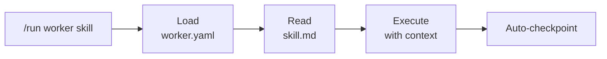
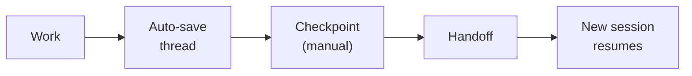

## Workers

Workers are AI agents with specific skills. Each worker has:

- **worker.yaml** — Configuration (type, skills, context, execution rules)
- **skills/** — Markdown files describing what the worker can do
- **src/** — Optional TypeScript source for MCP server integration

Workers are invoked with `/run {worker-id} {skill}`.



**Types:** CodeWorker, ContentWorker, ResearchWorker, OpsWorker, PersonaWorker, Library

Bundled workers live in `core/workers/public/`. Your own workers go in `personal/workers/` or `companies/{co}/workers/`. The list of all workers is `core/workers/registry.yaml`, which HQ regenerates from each `worker.yaml`.

## Knowledge Bases

Persistent memory stored as markdown and structured files. Knowledge bases are plain directories inside HQ.

```
core/knowledge/public/
├── Ralph/                  # Coding methodology
├── agent-browser/          # Browser automation
├── ai-security-framework/  # Security practices
├── brand-voice/            # Brand-voice packs
├── dev-team/               # Dev team patterns
├── getting-started/        # HQ cheatsheet
├── hq-core/                # HQ system docs
├── loom/                   # Agent patterns (reference)
├── projects/               # Project templates
└── workers/                # Worker framework docs
```

Your own knowledge goes in `personal/knowledge/` or `companies/{co}/knowledge/`. Keep these as real directories, not symlinks, so cloud sync uploads their contents.

## Commands

Slash commands (skills in `.claude/skills/`) orchestrate workflows. Run them inside your AI tool with `/command-name`.

**Categories:**
- **Session** — `/startwork`, `/checkpoint`, `/handoff`, `/learn`
- **Workers** — `/run`, `/newworker`
- **Projects** — `/prd`, `/run-project`, `/execute-task`
- **System** — `/search`, `/cleanup`, `/setup`

See [Commands](/hq/guide/4-commands/) for more.

## Checkpoints & Threads

HQ saves session state so work survives context limits.

- **Threads** (`workspace/threads/`) — Session summaries with git state, written by `/checkpoint` and `/handoff`
- **Checkpoints** (`workspace/checkpoints/`) — Legacy copies written by `/checkpoint`
- **Before autocompact** — Claude Code compacts older turns at 60% context (`CLAUDE_AUTOCOMPACT_PCT_OVERRIDE` in `.claude/settings.json`). When it does, a hook tells the agent to run `/checkpoint` on its next turn. Run `/handoff` yourself when you want to continue in a fresh session.



## Workspace

The `workspace/` directory is the runtime workspace:

| Directory | Purpose |
|-----------|---------|
| `threads/` | Auto-saved session state (JSON) |
| `checkpoints/` | Legacy copies written by `/checkpoint` |
| `learnings/` | Captured insights from task execution |
| `orchestrator/` | Project execution state |
| `reports/` | Generated reports |
| `insights/` | Insight files written by `/learn` |
| `drafts/` | Drafts |

## INDEX.md System

Hierarchical navigation maps throughout HQ. Each major directory has an `INDEX.md` providing a directory map, recent changes, and links.

- Auto-updated by commands (`/checkpoint`, `/handoff`, `/prd`, `/newworker`)
- Rebuild all with `/cleanup --reindex`

## Search (qmd)

HQ is indexed with [qmd](https://github.com/tobi/qmd) for local semantic and full-text search.

```bash
qmd search "stripe integration"     # BM25 keyword search
qmd vsearch "how to deploy"         # Semantic search
qmd query "best practices"          # Hybrid (best quality)
```

Or use the built-in command: `/search "your query"`

## Learning System

HQ learns from task execution:

- `/learn` — Captures a learning after a task, or manually when you run it. `/learn --hard` records a hard-enforcement rule.
- Rules become policy files in `personal/policies/`, `companies/{co}/policies/`, or a repo's `.claude/policies/`
- Insights become files under `workspace/insights/` or `companies/{co}/knowledge/insights/`
- `/learn` never writes to `core/`, because `/update-hq` replaces it
