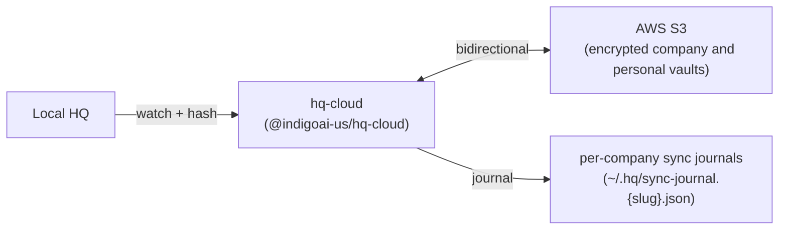

**hq-cloud** is the sync engine of the HQ ecosystem, published to npm as **`@indigoai-us/hq-cloud`** (currently **6.18.x**). It does the actual work of keeping a local HQ instance synchronized with cloud storage.

## What it is

- The bidirectional sync engine between a local HQ folder and the company and personal vaults in S3.
- A library plus binaries, chiefly `hq-sync-runner`, which emits ndjson sync events.
- Built on ESM + TypeScript with AWS SDK v3 (S3, Cognito), chokidar for file-change detection, and per-company local journals with SHA-256 hashing for conflict detection.

## Who uses it / when

You rarely invoke hq-cloud directly — it's consumed by other surfaces:

- The [`hq` CLI](/hq/products/hq-cli/) imports it for `hq sync` commands.
- The [HQ desktop app](/hq/products/hq-sync/) (macOS and Windows) spawns its `hq-sync-runner` and renders the progress events.

## What it does

- **Auth** against the shared Cognito identity. Tokens are cached at `~/.hq/cognito-tokens.json`.
- **Bidirectional file sync** to each company vault and your personal vault in S3.
- **Change detection** via chokidar. Built-in defaults skip VCS folders, build output, caches, and secrets. Add patterns to `.hqignore` at the HQ root (`.hqsyncignore` is the legacy name); `!pattern` re-includes a path. If `.hqinclude` exists, only paths matching it sync. `.gitignore` is not read; it does not affect what syncs.
- **Conflict resolution** via a per-company journal at `~/.hq/sync-journal.{slug}.json` that tracks per-file sync state. When both sides changed, the higher frontmatter `version:` wins (else the newer modification time); the losing copy is parked under `.hq/conflict-backups/` rather than written beside the live file. See [Cloud Sync](/hq/guide/8-cloud-sync/#conflict-resolution).

## Composition

hq-cloud is the single sync implementation in the ecosystem — both the CLI and the desktop app drive it rather than re-implementing sync. The cloud storage and identity it talks to are provisioned by [hq-pro](/hq/products/hq-pro/about/).

## Related

- [Cloud Sync guide](/hq/guide/8-cloud-sync/) — how sync behaves day to day
- [hq-cli](/hq/products/hq-cli/) — `hq sync` command surface
- [HQ desktop app](/hq/products/hq-sync/) — the desktop GUI over this engine
