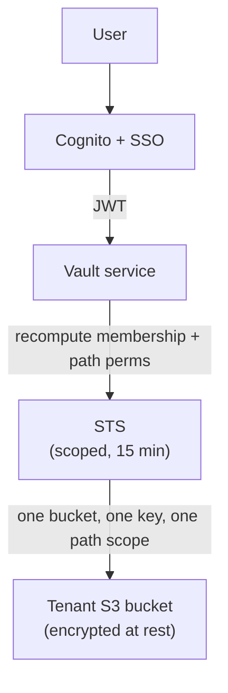

This page summarizes HQ's security architecture for security, IT, privacy, and procurement reviewers. It describes what is implemented today, draws a clear line between the local product and the cloud product, and states current limitations honestly. For the list of third parties that process customer data, see [Subprocessors](/hq/security/2-subprocessors/).

:::note[Where things run]
HQ has two layers. The **local layer** is the HQ directory and the desktop/CLI tools that run on your own machine. The **cloud layer** ([HQ Cloud](/hq/products/hq-cloud/) for personal sync and [HQ Pro](/hq/products/hq-pro/about/) for teams) is optional and stores synced content in AWS. Most of the controls below apply to the cloud layer; the local layer is governed by the [shared responsibility](#shared-responsibility) split.
:::

## Executive summary

HQ Cloud is hosted on AWS in the United States (`us-east-1`). HQ uses tenant-isolated storage: each customer organization and each person receives a **dedicated S3 bucket**, and access is brokered through **short-lived AWS STS sessions** that are recomputed per request and scoped to the tenant, the permitted paths, and the allowed operation. New vaults get a **dedicated AWS KMS key**; some existing vaults are encrypted with a shared Indigo-managed KMS key or with S3-managed keys (SSE-S3) until they are re-keyed.

Indigo does not use customer data to train models. Most of HQ's cloud-side AI features run on **AWS Bedrock** (Claude models). Live meeting voice for agents uses **OpenAI** APIs called from Indigo's servers. Hosted agents run on Indigo's AWS infrastructure and call Anthropic, OpenAI, or xAI with the model-provider sign-in or API key that the agent's owner supplies. The local agent tools (Claude Code, Cursor, Codex) run on your machine using **your own model-provider credentials** — that traffic goes from your machine to the provider you chose, and Indigo does not broker it. See [Subprocessors](/hq/security/2-subprocessors/) for the full list.

Indigo is **not yet SOC 2 or ISO certified**. The product is designed to align with the SOC 2 Trust Services Criteria, and readiness work is in progress. Implemented controls and current limitations are listed below.

## Review at a glance

| Question | Answer |
|---|---|
| Where is customer data hosted? | HQ's primary stores are in AWS `us-east-1`, United States. Some subprocessors process data in other locations; see [Subprocessors](/hq/security/2-subprocessors/). |
| How are tenants separated? | A separate S3 bucket per organization and per person, plus per-request scoped STS credentials. New vaults also get their own KMS key. |
| Is data encrypted at rest? | Yes. New vaults use SSE-KMS with a dedicated, Indigo-managed KMS key. Some existing vaults use a shared Indigo-managed KMS key or SSE-S3 until they are re-keyed. |
| Is data encrypted in transit? | Yes. TLS is enforced; bucket policy denies non-TLS requests. |
| How do users authenticate? | AWS Cognito with federated sign-in through Google and Microsoft (work, school, and personal accounts). Native self-registration is blocked. Desktop/CLI use OAuth2 Authorization Code with PKCE. |
| How is authorization enforced? | Organization roles plus path-scoped capabilities, translated into short-lived, narrowed AWS credential policies. |
| Is there audit logging? | Yes. An application audit trail for credential issuance and administrative actions, AWS CloudTrail management events (with log-file validation), and S3 server access logs on person and company vault buckets. |
| Are prompts or outputs used for model training? | No. Indigo does not train on customer data. See [Subprocessors](/hq/security/2-subprocessors/) for the AI providers HQ uses. |
| Can Indigo sign a DPA? | Yes, on request. GDPR and CCPA/CPRA support is available. |
| Any certifications today? | Not yet. SOC 2 and ISO certifications have not been completed. |

## Deployment model

HQ is **local-first with optional cloud sync**. The HQ directory and the agent tooling run on the customer's own machine (macOS and Windows; Linux is not supported yet). HQ Cloud is an optional layer that syncs content to AWS so it is available across people and devices.

This matters for security review because the customer's endpoint is part of the trust boundary: local files, locally configured credentials, and locally run AI agents are governed by the customer's own machine and policies. The [shared responsibility](#shared-responsibility) section makes the split explicit.

## Tenant isolation

Tenant isolation is HQ's strongest control. The vault does not rely only on an application-level tenant check in a shared store:

- Each organization receives a **separate S3 bucket** (`hq-vault-cmp-…`), and each person receives a personal bucket (`hq-vault-prs-…`).
- New vaults receive a **dedicated KMS key** with automatic annual rotation. Some existing vaults use a shared Indigo-managed KMS key or SSE-S3 until they are re-keyed.
- The vault defaults to **deny-all**. Access is granted as narrow, time-bound **capabilities**, not broad credentials.
- Every request **recomputes** organization membership and path permissions before issuing credentials.
- Access uses **short-lived AWS STS sessions** — 15 minutes by default, capped at one hour — scoped to one tenant bucket, that vault's key, and the authorized path.
- Requests **fail closed**: if a safe, scoped policy cannot be represented, the session is issued a deny-all policy rather than a broader one.
- CI includes **blocking end-to-end tests** that attempt cross-tenant access and assert denial.

## Identity and access management

HQ uses AWS Cognito for authentication and identity federation. Users sign in through **Google** or **Microsoft** (work, school, or personal accounts). Native self-registration in the Cognito pool is refused by a pre-sign-up check; machine and agent identities are created by HQ's own services.

Desktop and CLI authentication uses **OAuth2 Authorization Code with PKCE (S256)**, validates state, and uses a local loopback redirect. Access and ID tokens last **one hour**; refresh tokens for the desktop, CLI, and web console last **90 days**. Desktop tokens are stored in `~/.hq/cognito-tokens.json` with owner-only file permissions; signed macOS builds also keep a copy in the macOS Keychain.

Authorization combines **organization roles** (`owner`, `admin`, `member`, `guest`) with **path-scoped capabilities** (entitlement packs and ACLs). Customers can invite and remove members, assign roles, grant or revoke path access, and revoke sharing by removing a grant or letting a capability link expire.

Staff administrative access is restricted and logged; administrative and impersonation actions are recorded in the application audit trail. Customers' own identity-provider policy (MFA strength, conditional access, deprovisioning) remains part of the customer's posture.

## Encryption, sharing, and secrets

- **At rest** — new vaults are encrypted with **SSE-KMS** using a dedicated, Indigo-managed KMS key, with S3 bucket keys enabled. Some existing vaults use a shared Indigo-managed KMS key or S3-managed encryption (SSE-S3, AES-256) until they are re-keyed.
- **In transit** — TLS is enforced. Bucket policy includes an explicit **deny** for non-TLS (`aws:SecureTransport: false`) requests. S3 Public Access Block is enabled and object versioning is on.
- **Share links** — [hq-share](/hq/products/capabilities/hq-share/) mints **single-use, time-limited capability tokens** encrypted with **AES-256-GCM**. Tokens are pinned to specific paths, capped at write permission (they cannot grant admin), and enforce single use via an atomic nonce claim. The default lifetime is 15 minutes.
- **Secrets** — [hq-secrets](/hq/products/capabilities/hq-secrets/) stores customer secrets in **AWS SSM Parameter Store** as `SecureString` parameters, encrypted with the AWS-managed SSM key. Secrets are fetched into a process environment and are not printed to the terminal or committed to source control.

## AI and model-provider use

HQ uses AI in these places, and they have different data paths:

| Surface | Where it runs | Provider | Notes |
|---|---|---|---|
| Local agent work | On the customer's machine | The **customer's own** model-provider account (Claude Code, Cursor, Codex) | Indigo does not broker this. Traffic goes from the customer's machine to the provider they configured, under that provider's terms. |
| Cloud-side AI | Indigo's AWS backend | **AWS Bedrock**: Claude Sonnet 4.6 (global cross-region inference), Claude Haiku 4.5 (US cross-region inference), Amazon Titan Text Embeddings V2 (`us-east-1`) | Powers features such as meeting-signal extraction, ontology synthesis, and semantic search. With cross-region inference, Bedrock may process a request in an AWS region other than `us-east-1`. HQ has not enabled Bedrock model-invocation logging. |
| Live meeting voice for agents | Indigo's meeting service on AWS | **OpenAI** (realtime voice, speech, and a text model for questions about the meeting so far) | Used when an agent takes part in a meeting by voice. Meeting audio and transcript text are sent to OpenAI. |
| Hosted agents | Indigo's AWS infrastructure | The model provider the agent owner chooses: **Anthropic** (Claude), **OpenAI** (Codex), or **xAI** (Grok) | The agent signs in with the owner's own subscription or uses an API key the owner supplies. Prompts and agent context go to that provider under the owner's account terms. |

Indigo does **not** train models on customer data. Model inputs are limited to the content submitted or referenced for the requested action. Customers decide what content to submit to AI features.

:::note[On "Anthropic"]
Claude calls that HQ makes with Indigo's own credentials go through **AWS Bedrock**, not Anthropic's own API. A hosted agent running Claude calls Anthropic directly, using the subscription or API key its owner supplied. Local agent traffic uses the customer's own provider account and is a customer-connected tool, not an Indigo subprocessor.
:::

## Infrastructure and network security

HQ Cloud runs on managed AWS services, defined as code with SST v3 and reviewed through version control:

- **Compute** — AWS Lambda behind Amazon API Gateway (HTTP API with a JWT authorizer); long-running workloads use Amazon ECS Fargate.
- **Storage** — Amazon S3 for customer content; Amazon DynamoDB for metadata, access-control, and audit tables (point-in-time recovery enabled).
- **Network** — the vault service runs in a dedicated VPC. Its private subnets reach AWS services through **VPC endpoints**, and databases are not publicly accessible. Hosted-agent workloads share this VPC and can reach the internet: hosted company-agent instances run in public subnets with an internet gateway (no inbound security-group rules), and in production hosted-agent worker tasks run in the vault's private subnets and reach third-party model APIs through a NAT gateway. The agent meeting service runs in its own VPC, in public subnets behind a public load balancer.
- **Keys** — AWS KMS. New vaults get their own key with automatic annual rotation; some existing vaults use a shared Indigo-managed key or SSE-S3 until they are re-keyed.

HQ does not operate its own data centers; physical and environmental controls are inherited from AWS.

## Application security and SDLC

Development uses Git with reviewed pull requests, environment separation, and CI gates: type-checking, linting, automated tests, and **blocking cross-tenant isolation end-to-end tests**. Dependencies are pinned with committed lockfiles and frozen installs in CI. Dependabot and gitleaks secret scanning run on the hq-pro, hq-cli, and hq-desktop-app repositories.

Desktop app releases are **code-signed**: macOS builds with an Apple Developer ID certificate and **notarized by Apple**, Windows installers with Authenticode through Azure Trusted Signing. Updates are **cryptographically signed** (the updater verifies a minisign signature before applying an update).

HQ has **not yet completed an independent third-party penetration test**. Internal security review and adversarial testing are used while an external assessment is planned.

## Monitoring, audit, and investigation

- **CloudTrail** records AWS management events, with multi-region coverage and **log-file validation** for tamper evidence. CloudTrail data events on vault buckets were turned off on 2026-09-24.
- **S3 server access logs** are configured on person and company vault buckets and loaded into ClickHouse for analysis and investigation. AWS delivers these logs on a best-effort basis: records can arrive hours late and a small fraction may not arrive, so they are not a complete audit record.
- An **application audit trail** (DynamoDB) records security-relevant events such as credential issuance, the requesting identity and source IP, the paths and operations involved, and administrative actions.
- **CloudWatch** is used for application logs, metrics, and alarms.
- **Sentry** is used for error and performance monitoring, with authentication tokens and local filesystem paths scrubbed before transmission; it is not intended to receive customer content.

## Compliance and privacy

Indigo does not currently claim SOC 2 or ISO certification. HQ controls are designed to align with the SOC 2 Trust Services Criteria for Security, Availability, and Confidentiality, and readiness work is in progress.

GDPR and CCPA/CPRA support is available through data-handling practices, data-subject-request support, and a Data Processing Addendum (with Standard Contractual Clauses where needed). **EU or other non-US data residency is not currently offered.** Export and deletion are available on request.

## Shared responsibility

| Indigo secures | The customer secures |
|---|---|
| Tenant isolation, encryption, platform authentication and authorization, infrastructure and application security, backups, incident response, and subprocessor management. | Their identity-provider policy and MFA enforcement, member and role assignment, what data is synced or shared, credentials granted to local agents, endpoint security, and oversight of AI agent actions. |

## Current limitations

State these plainly during review:

- No SOC 2 or ISO certification has been completed yet.
- No independent third-party penetration test has been completed yet.
- HQ Cloud runs in a **single AWS region** with no automated cross-region failover; formal RPO/RTO targets and tested restore drills are being finalized.
- **Native in-platform MFA is not available**; MFA is enforced through the customer's identity provider.
- **Refresh-token rotation is not yet enabled.**
- Customer-owned keys (BYOK) and end-to-end (zero-knowledge) encryption are not offered; tenant keys are Indigo-managed in AWS KMS.
- Not every existing vault has its own KMS key yet; some use a shared Indigo-managed key or SSE-S3 until they are re-keyed.
- S3 data access is recorded through best-effort S3 server access logs, not CloudTrail data events.
- Dependabot covers the hq-pro, hq-cli, and hq-desktop-app repositories only; SBOM generation is not implemented.
- Some internal administrative functions retain broader permissions than the steady-state customer data path; they are restricted and audited.

## Detailed topics

This overview is the summary. Deeper, reviewer-oriented detail lives in the rest of this section:

- [Tenant Isolation](/hq/security/3-tenant-isolation/) — per-company bucket, KMS keys, scoped STS, fail-closed
- [Data Security & Encryption](/hq/security/4-data-security-encryption/) — classification, keys, retention, deletion
- [Identity & Access Management](/hq/security/5-identity-access-management/) — SSO, PKCE, tokens, RBAC, staff access
- [Infrastructure & Network Security](/hq/security/6-infrastructure-network-security/) — AWS region, VPC, IaC, secrets
- [Application Security & SDLC](/hq/security/7-application-security-sdlc/) — CI gates, dependencies, signed builds
- [Shared Responsibility](/hq/security/8-shared-responsibility/) — what Indigo secures vs. the customer
- [Subprocessors](/hq/security/2-subprocessors/) — third parties that process customer data
- [Business Continuity & Incident Response](/hq/security/9-business-continuity-incident-response/) — backups, recovery, breach notification
- [Compliance Roadmap](/hq/security/10-compliance-roadmap/) — SOC 2 / ISO / GDPR / CCPA status
- [Vulnerability Disclosure](/hq/security/11-vulnerability-disclosure/) — how to report, scope, safe harbor
- [CAIQ Questionnaire](/hq/security/12-caiq-questionnaire/) — pre-filled cloud-control answers

## Reporting and contact

Security questions, documentation requests, vulnerability reports, and privacy requests go to **security@hqforwork.com**. For sensitive vulnerability details, request an encrypted channel in your first message.
